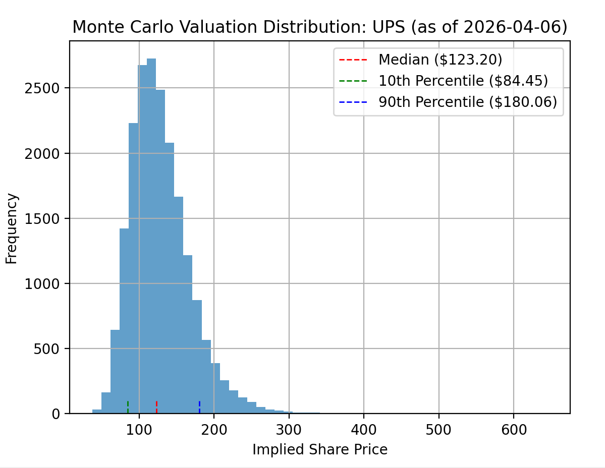

#How to use

## STEP 0: Install all relevant python packages 
(reccomended to install into a virtual environment to avoid conflicts)
```bash
python -m venv venv
.\.venv\Scripts\activate # In the same directory
python -m pip install yfinance numpy pandas matplotlib yaml
```

## STEP 1: Copy and edit default_yaml.yaml with a code editor of your choice
```bash
cp default_yaml.yaml my_stock.yaml
code my_stock.yaml
```

## STEP 2: Run the main monte carlo script to calculate a DCF of your stock, presented via a distribution. 
```bash
python monte_carlo_generic.py my_stock.yaml
```

## Notes and other tips

Historical examples of some of the DCFs I have run are in the sample configs folder for those interested in how I run these DCFs. 
Some have notes on where I have pulled my assumptions from. Often, this is as simple as CapIQ, or calculated manually from earnings reports. 

Output should look like:
